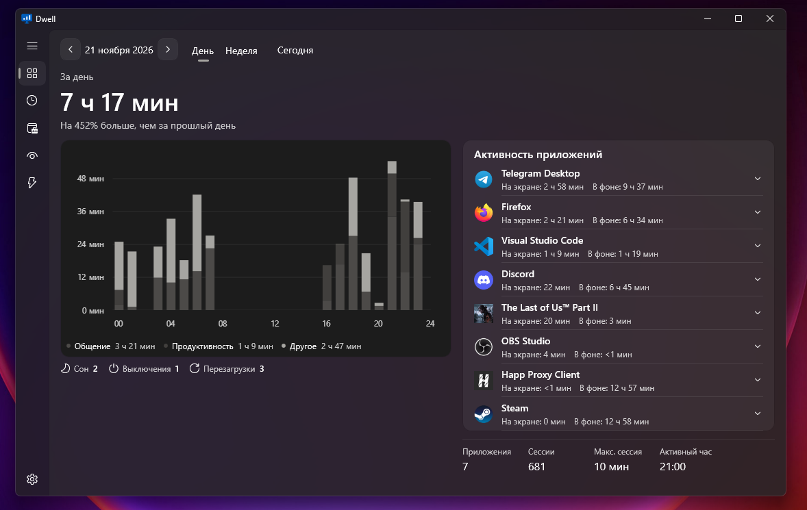

# Dwell

[](https://github.com/zephrx0/Dwell/releases/latest)  

Dwell показывает, сколько времени ты проводишь в приложениях и сколько они работают в фоне. C#, WinUI 3, SQLite.



[English](#english)

## Установка

Скачай и запусти `Dwell-Setup.exe`. Подойдёт Windows 10 версии 1809 или новее на x64 и Windows 11 на x64 или ARM64 с эмуляцией x64. .NET уже входит в установщик. [Скачать последнюю версию](https://github.com/zephrx0/Dwell/releases/latest/download/Dwell-Setup.exe)

Dwell работает в трее и показывает уведомление, когда появляется обновление. Проверить и установить его можно через «Настройки → Обновления». [Что изменилось в релизах](https://github.com/zephrx0/Dwell/releases)

## Учёт времени

В «Обзоре» можно посмотреть статистику за день или неделю. В «Активности» есть история сеансов и экспорт в CSV.

Чтобы убрать программу из обзора, раскрой её строку и нажми «Исключить из статистики». Вернуть приложение вместе с историей можно в разделе «Скрытые приложения». В «Лимитах и отдыхе» настраиваются дневные лимиты, расписание отдыха и напоминания о перерывах.

История и настройки хранятся на твоём компьютере. Учёт времени работает офлайн.

## Энергопотребление

График показывает мощность процессора и видеокарт за последние 24 часа. Каждый столбец — среднее за 15 минут. Над графиком можно выбрать сумму или отдельный датчик. Нажми на строку процессора, чтобы открыть показания ядер.

На некоторых ПК Windows не предоставляет доступ к счётчику мощности процессора. В таком случае Dwell показывает доступную загрузку в процентах и помечает сумму в ваттах как неполную. На x64 официальная подписанная версия PawnIO может открыть доступ к датчику. Dwell обнаружит драйвер при следующей проверке. Если датчику нужны права администратора, закрой Dwell через трей и запусти его от имени администратора. [Загрузить PawnIO с сайта разработчика](https://pawnio.eu/)

## English

Dwell tracks time spent in Windows apps. Open **Overview** to see what was on screen or running in the background on a given day or week. **Activity** shows individual sessions and lets you export them as CSV. History and settings stay on your PC.

Expand an app in Overview to hide it from statistics. **Hidden apps** brings it back with its history. Use **Limits and breaks** to set daily limits and schedule reminders.

Run the installer on x64 Windows 10 version 1809 or later, or on Windows 11 with x64 or ARM64 with x64 emulation. The .NET runtime is included. Updates are available in **Settings → Updates**. [Download Dwell-Setup.exe](https://github.com/zephrx0/Dwell/releases/latest/download/Dwell-Setup.exe)

### Power usage

The chart shows CPU and GPU power over the last 24 hours. Each bar is a 15-minute average. Pick a sensor above the chart or expand the processor row to see its core readings.

If Windows provides no CPU power counter, Dwell shows available CPU utilization as a percentage and marks the total in watts as incomplete. On x64, the official signed PawnIO driver can provide access to CPU power sensors on supported hardware. Dwell will pick up the driver on its next check. If the sensor requires administrator access, exit Dwell from the tray and run it as administrator. [Get PawnIO from its developer](https://pawnio.eu/)

## Build

Build on Windows with the .NET 10 SDK and Inno Setup 6.3 or later.

```powershell
powershell -NoProfile -ExecutionPolicy Bypass -File build.ps1
```

The script builds Dwell, runs its tests, and puts `Dwell-Setup.exe` in a versioned directory under `artifacts`. To sign the app and installer, put Windows SDK SignTool on PATH and set `DWELL_SIGN_CERT_THUMBPRINT` to the thumbprint of the publisher’s code-signing certificate.

Dwell reads hardware sensors through LibreHardwareMonitor. [Third-party licenses](src/Dwell/HardwareSensorNotices.txt)
